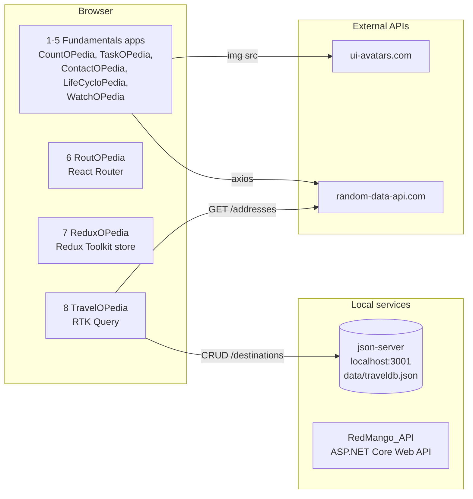

# React Projects

A collection of progressively more advanced React mini projects, ending with a full-stack app (**Red Mango**) backed by an ASP.NET Core Web API. Each numbered folder is a self-contained Create React App project that introduces one new set of React concepts on top of the previous ones.

## Table of Contents

- [Tech Stack](#tech-stack)
- [Architecture](#architecture)
- [Services](#services)
- [Repository Structure](#repository-structure)
- [Getting Started](#getting-started)
- [Mini Projects and Patterns](#mini-projects-and-patterns)
- [Learning Path at a Glance](#learning-path-at-a-glance)
- [Known Issues](#known-issues)

## Tech Stack

| Layer            | Technology                                                       |
| ---------------- | ---------------------------------------------------------------- |
| UI               | React 18 / React 19, JSX                                         |
| Tooling          | Create React App (`react-scripts` 5)                             |
| Styling          | Bootstrap 5 + Bootstrap Icons (via CDN), inline styles           |
| Routing          | React Router v6                                                  |
| State management | Component state, Hooks, Redux Toolkit, RTK Query                 |
| HTTP             | Axios, RTK Query `fetchBaseQuery`                                |
| Mock backend     | json-server                                                      |
| Backend          | ASP.NET Core Web API (`RedMango_API`)                            |

## Architecture

The repository is a **multi-project monorepo**. The projects don't share code or dependencies, and each one has its own `package.json`, `node_modules`, and dev server. You can run them independently.



Every React app follows the same CRA layout:

```
<project>/
├── public/index.html   # Loads Bootstrap + Bootstrap Icons from CDN, mounts #root
├── src/
│   ├── index.js(x)     # Entry point: ReactDOM.createRoot(...).render(...)
│   ├── Layout/ or Components/Layout/   # Header / Footer
│   ├── Components/ or components/      # Feature components
│   ├── Images/         # Static assets
│   └── ...             # Utility/api, redux/, api/, Pages/ depending on the project
└── package.json
```

## Services

| Service                    | Location                                   | Port   | Used by       | Description                                                                   |
| -------------------------- | ------------------------------------------ | ------ | ------------- | ----------------------------------------------------------------------------- |
| React dev server           | each project folder                        | `3000` | all projects  | `react-scripts start`. If 3000 is taken, CRA offers the next free port.     |
| json-server (mock REST)    | `8 travelOpedia/travelopedia/data/traveldb.json` | `3001` | TravelOPedia  | Serves `/destinations` with full CRUD (GET/POST/PUT/DELETE).                  |
| Random Data API (external) | `https://random-data-api.com/api/v2/`      | –      | ContactOPedia, LifeCycloPedia, TravelOPedia | Generates random users and addresses.                                  |
| UI Avatars (external)      | `https://ui-avatars.com/api/`              | –      | ContactOPedia | Builds avatar images from contact names.                                    |
| RedMango_API               | `RedMango_API/`, `.NET setup/RedMango_API` | –      | Red Mango     | ASP.NET Core Web API backend, tracked as a git submodule (see [Known Issues](#known-issues)). |

## Repository Structure

```
React_Projects/
├── 1 taskOPedia/taskopedia/        # CountOPedia: class components & state
├── 2 countOpedia/                  # TaskOPedia: JSX, props, composition
├── 3 contactOPedia/contactopedia/  # ContactOPedia: CRUD with lifted state
├── 4 lifecyclopedia/cyclopedia/    # LifeCycloPedia: lifecycle methods vs hooks
├── 5 watchOpedia/watchopedia/      # WatchOPedia: useState & controlled forms
├── 6 routOpedia/routopedia/        # RoutOPedia: React Router v6
├── 7 reduxOpedia/reduxopedia/      # ReduxOPedia: Redux Toolkit
├── 8 travelOpedia/travelopedia/    # TravelOPedia: RTK Query + json-server
├── RedMango_API/                   # .NET Web API (submodule)
└── .NET setup/RedMango_API/        # .NET Web API setup (submodule)
```

> **Note:** The folder names for projects 1 and 2 are swapped relative to the app titles. `1 taskOPedia` renders **CountOPedia**, and `2 countOpedia` renders **TaskOPedia**.

## Getting Started

### Prerequisites

- [Node.js](https://nodejs.org/) 18+ and npm
- [.NET SDK](https://dotnet.microsoft.com/download) (only for `RedMango_API`)
- Git

### Clone

```bash
git clone --recurse-submodules <repo-url>
cd React_Projects
```

### Run any React mini project

```bash
cd "3 contactOPedia/contactopedia"   # or any other project folder
npm install
npm start
```

Then open <http://localhost:3000>.

Every project has the standard CRA scripts:

| Script          | Description                                  |
| --------------- | -------------------------------------------- |
| `npm start`     | Start the dev server with hot reload         |
| `npm run build` | Create a production build in `build/`        |
| `npm test`      | Run Jest in watch mode                       |
| `npm run eject` | Eject from CRA (one-way, not recommended)    |

### Run TravelOPedia (needs the mock API)

TravelOPedia expects a REST API at `http://localhost:3001`. Start json-server in one terminal and the app in another:

```bash
# Terminal 1: mock backend
cd "8 travelOpedia/travelopedia"
npx json-server@0.17.4 --watch data/traveldb.json --port 3001

# Terminal 2: React app
cd "8 travelOpedia/travelopedia"
npm install
npm start
```

> json-server isn't listed in `package.json`. Pinning `0.17.4` avoids CLI changes in the 1.x betas.

### Run RedMango_API

```bash
git submodule update --init --recursive
cd RedMango_API
dotnet restore
dotnet run
```

## Mini Projects and Patterns

### 1. CountOPedia (`1 taskOPedia/taskopedia`)

An attack/defense counter game: you win at +10 and lose at -10.

**Patterns implemented**
- **Class components** that extend `React.Component`, with a `constructor` and `render()`
- **Local component state** using `this.state` and `this.setState`
- **Functional `setState` updater** (`setState(prev => ...)`), so new state is computed from the previous state
- **Event handling** with class-field arrow functions and explicit `.bind(this)`
- **Derived UI state** (`gameStatus`) computed from the score
- Importing **static image assets** into components

### 2. TaskOPedia (`2 countOpedia`)

A static course landing page that lists enrolled students.

**Patterns implemented**
- **JSX fundamentals**: expressions, attributes, and inline `style` objects
- **Functional components** written both as `function` declarations and as arrow functions
- **Props** to pass data into reusable components (`<Student name experience headshot />`)
- **Composition with `props.children`**: `StudentReview` is rendered inside `Student`
- **Layout components** (`Header`, `SubHeader`, `Footer`) split out from the main body
- Mixing **external CSS classes** and **inline style objects**

### 3. ContactOPedia (`3 contactOPedia/contactopedia`)

A contact manager with add, update, delete, favorite, and "add random contact" features.

**Patterns implemented**
- **Lifting state up**: `ContactIndex` owns `contactList` and passes callbacks down
- **Container / presentational split**: `ContactIndex` (container) vs `Contact`, `FavouriteContact`, `GeneralContact` (presentational)
- **Callback props** for child-to-parent communication (`handleContact`, `toggleFavorite`, `deleteContact`, ...)
- **Immutable updates** with `map`, `filter`, `concat`, and object spread
- **Uncontrolled form** that reads values from `e.target.elements`, with **validation** and duplicate detection
- **Conditional rendering** for create vs update mode and for error messages
- **Rendering lists with keys** and **filtered derived lists** (favorites vs others)
- **API utility layer** (`Utility/api.jsx`) wrapping **Axios** with `async/await`

### 4. LifeCycloPedia (`4 lifecyclopedia/cyclopedia`)

Shows the same instructor/student/feedback page twice: once as a class component and once as a function component.

**Patterns implemented**
- **Class lifecycle methods**: `componentDidMount`, `componentDidUpdate(prevProps, prevState)`, `componentWillUnmount`
- **Hooks equivalents**: `useState` (with lazy initializers) and `useEffect` with **dependency arrays**
- **Side effects**: data fetching on mount and when a value changes (student count, instructor toggle)
- **Persisting state** to `localStorage` and restoring it on mount (class version)
- **Controlled inputs** (`value` + `onChange`) for the name and feedback fields
- **Optional chaining with fallbacks** (`instructor?.name || "Loading..."`) for async data
- Class vs function versions of the same presentational component (`Instructor` / `InstructorFunc`)

### 5. WatchOPedia (`5 watchOpedia/watchopedia`)

A counter and a movie watch-list.

**Patterns implemented**
- **`useState` hook** with functional updates and object state spread (`{ ...prevState }`)
- **Controlled form component** (`AddMovie`) that resets after submit
- **Parent-owned list state** passed to sibling components (`MoviePage` → `MovieList` + `AddMovie`)
- **`React.StrictMode`** in the root render

### 6. RoutOPedia (`6 routOpedia/routopedia`)

A multi-page navigation shell with Home, About, and Product pages.

**Patterns implemented**
- **Client-side routing** with `BrowserRouter`, `Routes`, `Route`
- **Nested routes** under `/product` (`create`, `details`, `list`, and an index path)
- **Catch-all 404 route** (`path="*"` → `NotFound`)
- **`NavLink`** for active-aware navigation in a Bootstrap navbar with a dropdown
- **Programmatic navigation** with the `useNavigate` hook
- **Pages vs Components** folder separation

### 7. ReduxOPedia (`7 reduxOpedia/reduxopedia`)

A global counter (with multiplier) and a destination list with a detail view.

**Patterns implemented**
- **Centralized store** with Redux Toolkit `configureStore` and multiple slice reducers
- **Slices** (`createSlice`) with Immer-powered "mutating" reducers
- **Actions with payloads** (`incrementMultiplier(multiplier)`)
- **Shared cross-slice action** using `createAction` + `extraReducers` (`builder.addCase`), so one action resets several slices
- **`Provider`** at the root, with **`useSelector`** / **`useDispatch`** in components
- Mixing **local UI state** (`useState` for the multiplier input) with **global state**
- Feature-based folders: `redux/slice`, `redux/actions`, `app/components`

### 8. TravelOPedia (`8 travelOpedia/travelopedia`)

A travel destination manager with full CRUD against a REST API, plus a random travel suggestion.

**Patterns implemented**
- **RTK Query** (`createApi` + `fetchBaseQuery`) as the data-fetching and caching layer
- **Queries and mutations** with auto-generated hooks (`useGetAllDestinationsQuery`, `useAddDestinationMutation`, ...)
- **Cache invalidation with tags** (`providesTags` / `invalidatesTags`), so the list refetches after create/update/delete
- **`transformResponse`** to sort server data before it reaches components
- **Multiple API slices** registered in one store, with their middleware composed via `getDefaultMiddleware().concat(...)`
- **Loading / success / error** UI states from query hook flags
- **Inline edit mode** that toggles a row between view and edit with local state
- **Mock REST backend** with json-server

### RedMango_API

The backend for the Red Mango full-stack app, built with **ASP.NET Core Web API**. It's included as a git submodule, so its source lives in its own repository.

## Learning Path at a Glance

| # | Project        | Key concepts                                           | React | Extra libraries                 |
|---|----------------|--------------------------------------------------------|-------|---------------------------------|
| 1 | CountOPedia    | Class components, `setState`, events                   | 18    | –                               |
| 2 | TaskOPedia     | JSX, props, `children`, composition                    | 18    | –                               |
| 3 | ContactOPedia  | Lifting state, CRUD, forms, Axios                      | 18    | axios                           |
| 4 | LifeCycloPedia | Lifecycle methods vs `useEffect`, localStorage         | 19    | axios                           |
| 5 | WatchOPedia    | `useState`, controlled forms                           | 19    | –                               |
| 6 | RoutOPedia     | React Router v6, nested routes, `useNavigate`          | 19    | react-router-dom                |
| 7 | ReduxOPedia    | Redux Toolkit, slices, `createAction`, `extraReducers` | 19    | @reduxjs/toolkit, react-redux   |
| 8 | TravelOPedia   | RTK Query, tag invalidation, REST CRUD                 | 19    | @reduxjs/toolkit, json-server   |
| – | RedMango_API   | ASP.NET Core Web API                                   | –     | .NET                            |

## Known Issues

- **Submodules aren't fully configured.** `RedMango_API` and `.NET setup/RedMango_API` are committed as submodule pointers, but the repo has no `.gitmodules` file, so `git submodule update` can't fetch them yet. Add the remote with `git submodule add <url> RedMango_API` to fix this.
- **Random Data API availability.** `random-data-api.com` is an external service. If it's down or rate-limited, the "random" features in ContactOPedia, LifeCycloPedia, and TravelOPedia will fail.
- **Port collisions.** Every app defaults to port `3000`. Run one at a time, or accept CRA's prompt to use another port. TravelOPedia's json-server must stay on `3001`.
